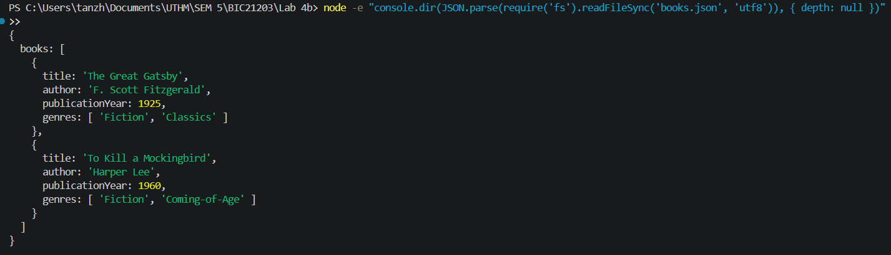
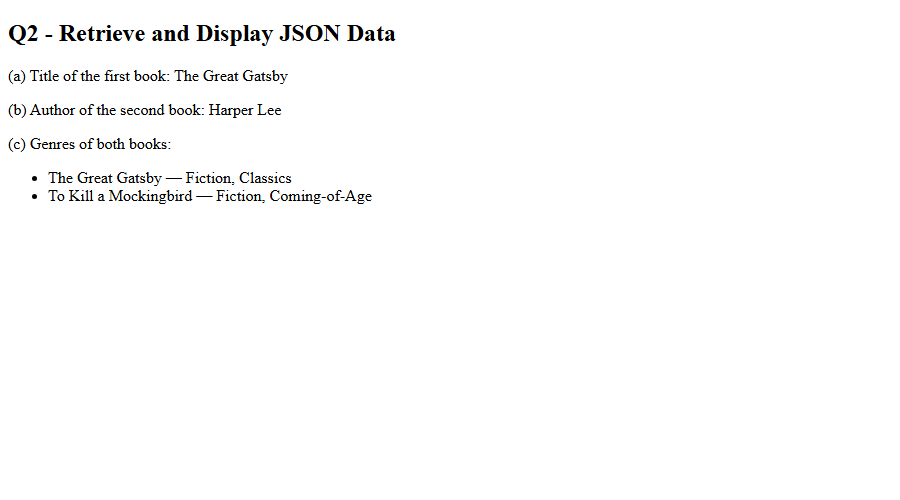
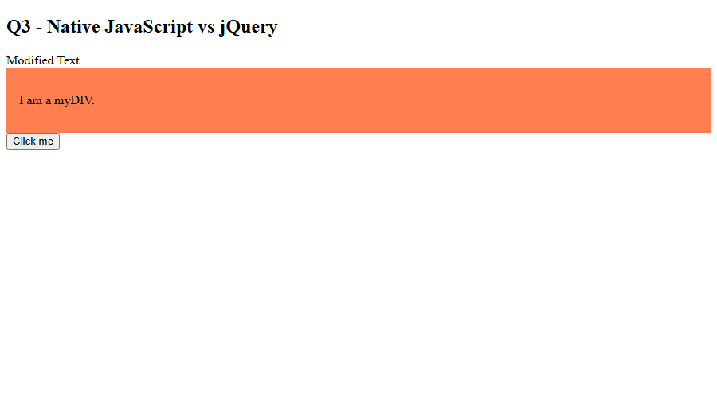

# BIC21203 Lab 4b - JSON and jQuery

**Name:** Tan Zhuo You
**Student ID:** AI240173

## Files

- `books.json` - Q1: A `books` array with two book objects (title, author, publicationYear, genres).
- `books.html` - Q2: Uses `fetch()` to read `books.json` and shows the first book's title, the second book's author and the genres of both books. Shows an error message if the data cannot be loaded.
- `jquery-dom.html` - Q3: Uses jQuery 4.0.0 `.text()`, `.addClass()` and `.on("click", ...)` to change the text, add the `myStyle` class and show "Button clicked!".

## How to Run

`fetch()` does not work with `file://`, so use a local server:

1. Open this folder in VS Code.
2. Install the **Live Server** extension.
3. Right-click `books.html` and choose **Open with Live Server**.
4. Open `jquery-dom.html` the same way (needs internet for the jQuery CDN).

## Screenshots

### Q1
`books.json` parses successfully with `JSON.parse()` in Node.js:

### Q2

### Q3

